  <picture>
    <source media="(prefers-color-scheme: dark)" srcset="hero-dark.svg">
    <source media="(prefers-color-scheme: light)" srcset="hero-light.svg">
    
  </picture>

I write TypeScript and Rust, self-host what I depend on, and spend the rest of the time measuring networks that lie.

## Selected work

| Project | What it does | Stack |
| --- | --- | --- |
| **[Qwen Gate](https://github.com/youssefvdel/qwengate)** | A drop-in OpenAI-compatible gateway for Qwen models | TypeScript · Bun |
| **[Recon](https://github.com/youssefvdel/Recon)** | Live lobby scouting and in-game HUD widgets for VALORANT | TypeScript · Rust · Tauri |
| **[Qwen Studio](https://github.com/youssefvdel/qwen-studio)** | The Qwen Studio desktop app, ported to Linux | Rust |
| **[docsGround](https://github.com/youssefvdel/docsGround)** | Documentation grounding and search for agents, indexed in SQLite | TypeScript |
| **[better-ubuntu](https://github.com/youssefvdel/better-ubuntu)** | One command to debloat Ubuntu: scans, fixes, prints a report | Rust |
| **[XVX G75 driver](https://github.com/youssefvdel/xvx-g75-linux-driver)** | Reverse-engineering a keyboard's Windows driver for Linux | Shell |
| **[Solar Tracker](https://github.com/youssefvdel/Solar-Tracker-Embedded)** | An ESP32 that tracks the sun with dual LDRs and a servo | C++ |

## Recently pushed

refreshed daily by [the ship-log workflow](.github/workflows/ship-log.yml)

<!-- ship:begin -->
[Recon](https://github.com/youssefvdel/Recon) 2026-11-10 · [youssefvdel.github.io](https://github.com/youssefvdel/youssefvdel.github.io) 2026-11-10 · [react-ui-skill](https://github.com/youssefvdel/react-ui-skill) 2026-10-27 · [stacklist](https://github.com/youssefvdel/stacklist) 2026-10-27 · [GameDesignLabs](https://github.com/youssefvdel/GameDesignLabs) 2026-10-26
<!-- ship:end -->
<!-- ship:end -->

## What I work with

TypeScript · Rust · Go · Bun · Node · Linux (systemd, nginx) · Cloudflare · SQLite · Postgres

## Elsewhere

[Portfolio](https://youssefvdel.dpdns.org) · [youssefvdel@gmail.com](mailto:youssefvdel@gmail.com)
