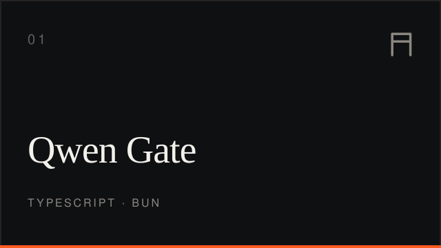
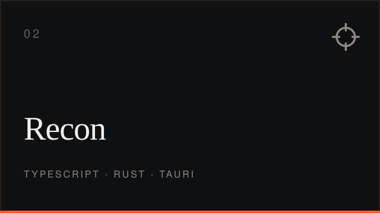
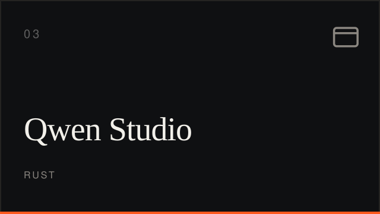
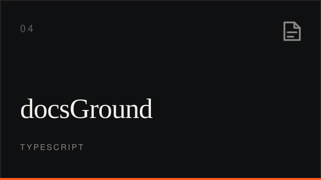
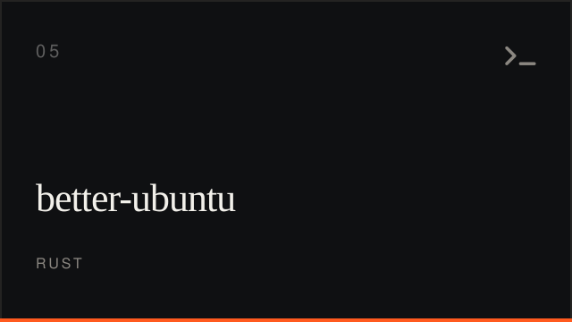
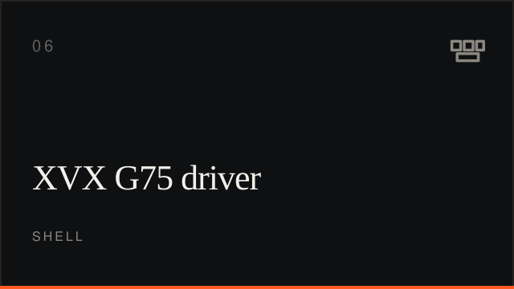
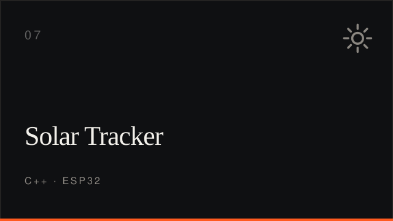

  <picture>
    <source media="(prefers-color-scheme: dark)" srcset="hero-dark.svg">
    <source media="(prefers-color-scheme: light)" srcset="hero-light.svg">
    
  </picture>

I write TypeScript and Rust, self-host what I depend on, and spend the rest of the time measuring networks that lie.

**[Point here](https://github.com/youssefvdel/point-here)** is the map I hand to an AI agent: where the truth lives, how I work, what I reach for.

## Selected work

| | |
| :---: | :---: |
|  |  |
|  |  |
|  |  |
|  | |

Qwen Gate — OpenAI-compatible gateway for Qwen · Recon — VALORANT scouting and HUD · Qwen Studio — the desktop app on Linux · docsGround — documentation grounding for agents · better-ubuntu — one-command debloat · XVX G75 — reverse-engineering a keyboard driver · Solar Tracker — ESP32 sun tracking

## Recently pushed

refreshed daily by [the ship-log workflow](.github/workflows/ship-log.yml)

<!-- ship:begin -->
[point-here](https://github.com/youssefvdel/point-here) 2026-11-10 · [Recon](https://github.com/youssefvdel/Recon) 2026-11-10 · [youssefvdel.github.io](https://github.com/youssefvdel/youssefvdel.github.io) 2026-11-10 · [react-ui-skill](https://github.com/youssefvdel/react-ui-skill) 2026-10-27 · [GameDesignLabs](https://github.com/youssefvdel/GameDesignLabs) 2026-10-26
<!-- ship:end -->

## What I work with

TypeScript · Rust · Go · Bun · Node · Linux (systemd, nginx) · Cloudflare · SQLite · Postgres

## Elsewhere

[Portfolio](https://youssefvdel.dpdns.org) · [Point here](https://github.com/youssefvdel/point-here) · [youssefvdel@gmail.com](mailto:youssefvdel@gmail.com)
